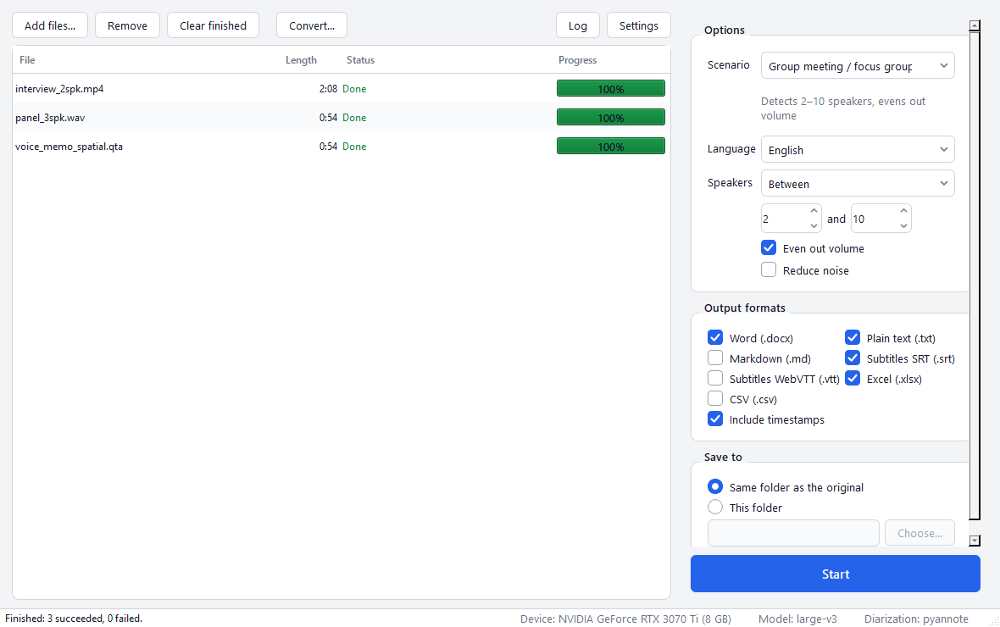

# LocalScribe

Offline transcription with speaker identification for Windows. LocalScribe turns interviews, meetings, lectures and voice memos into transcripts that show who said what. **Everything runs on your own computer; recordings are never uploaded.**



*中文說明請見下方 [中文說明](#中文說明)。*

- [Features](#features)
- [Download and install](#download-and-install)
- [Usage](#usage)
- [Settings](#settings)
- [Output formats](#output-formats)
- [Accuracy and speed](#accuracy-and-speed)
- [Optional: pyannote](#optional-pyannote-free-one-time)
- [Troubleshooting](#troubleshooting)
- [FAQ](#faq)
- [Running from source](#running-from-source)

## Features

- Drag and drop audio or video (mp3, m4a, wav, flac, mp4, mov, mkv, webm, …) and queue many files at once
- **iPhone Voice Memos (.qta) work directly** (the iOS 18.2+ format). LocalScribe uses the file's stereo AAC track and skips the Apple spatial-audio track that Windows can't decode. Files with other extensions are accepted whenever FFmpeg finds audio in them
- **Converter** to M4A, MP3, WAV or FLAC for playback elsewhere. It keeps the recording's title and date and never overwrites files
- **Speech recognition**: Whisper (faster-whisper). It uses large-v3 on NVIDIA GPUs and small on computers without one
- **Speaker identification**, both free:
  - **pyannote** (community-1): the most accurate; needs a one-time free Hugging Face token (see below)
  - **sherpa-onnx**: built in, no account needed; used whenever pyannote isn't installed
- **Scenario presets**: one-on-one interview (exactly 2 speakers), group meeting (2–10), lecture (any number), online meeting (any number, with noise reduction)
- **Word banks**: your own lists of technical terms, e.g. one per course, that help Whisper spell jargon. Pick one for each batch of recordings
- **Proofreading aids**: optionally mark the words Whisper was unsure of, so you know where to listen again. Long stretches without text are marked in the transcript, with a note when speech was heard there
- **Exports**, any combination: Word, plain text, Markdown, SRT, WebVTT, Excel, CSV. Every run also saves a `_transcript.json` for future editing tools
- Never overwrites: a repeated run saves `name_transcript (2).docx`
- English or Traditional Chinese interface (follows Windows; change it in Settings)

## Download and install

1. Open **[Releases](https://github.com/alston001/localscribe/releases)** and download **every file** of the latest version: `LocalScribe-Setup-x.y.z.exe` and its `.bin` parts. GitHub limits files to 2 GB, so the installer is split.
2. Put them in **one folder** and run the `.exe`. It installs for your user account only (no admin rights needed).
3. The installer isn't code-signed, so Windows may say "Windows protected your PC". Click **More info → Run anyway**.

**Updates**: from 0.1.4 on, LocalScribe checks for a new version when it starts, at most once a day. When there is one, a strip above the file list offers it. **Update** downloads it in the background, and **Restart now** installs it and opens LocalScribe again. It waits while a transcription runs, and settings, word banks and models are kept. Usually only the files that changed are downloaded, in a small update installer of about 75 MB; when bundled libraries such as PyTorch change, it is the full installer. Turn the check off, or check by hand, under **Settings → General → Updates**. A copy unzipped from the portable ZIP opens the download page instead. Each release also has `LocalScribe-Update-x.y.z.exe`, which updates the version before it by double-click.

**Requirements**

| | Minimum | Recommended |
|---|---|---|
| System | Windows 10 or 11, 64-bit | |
| Disk | 5 GB for the app + 0.5 GB for the CPU model | 5 GB + 3 GB for the GPU model |
| Memory | 8 GB RAM | 16 GB RAM |
| GPU | none (runs on the CPU, much slower) | NVIDIA with 6 GB+ VRAM and a recent driver (CUDA 12) |

## Usage

1. Drop files into the window (or click **Add files…**)
2. Pick a **scenario**, the **language**, a **word bank** if you have one, and the **output formats**
3. Click **Start**. The first run downloads the Whisper model (about 3 GB with a GPU, 480 MB without); after that everything works offline
4. Double-click a finished row to open the transcript; right-click to proofread it, open its folder, see an error, or run it again

**How it works**: FFmpeg decodes the file to 16 kHz mono → a voice detector finds speech and cuts it into clips of up to 28 s at natural pauses → Whisper transcribes each clip with word timestamps → lines it invents where nobody spoke (video credits, or an unsure "Thanks for watching!" or 謝謝觀看) are removed → pyannote or sherpa-onnx works out who spoke when → each word is matched to a speaker, and boundary words that land on the wrong side of a speaker change are pulled back into their sentence → the result is written in every format you picked.

**Word banks**: Whisper often mishears technical terms (e.g. "tokenization" written as "organization"). Keep the terms of each course or topic in a word bank and pick it before you click **Start**. In the **Word bank** menu, choose **+ New word bank…**, give it a name such as "NLP class" and enter one term per line (a pasted comma-separated list works too). The pencil and bin icons in the same menu edit and delete banks; type in its search box to find one. The chosen bank's terms are combined with **Settings → Names and terms**, bank first. Whisper reads only the first 223 tokens of these terms: about 55 English terms, or 35 Chinese ones. The editor counts them as you type, and if the bank and Names and terms together go over, LocalScribe lists the terms that would be left out before the run starts. Banks are saved in `%LOCALAPPDATA%\LocalScribe\vocabularies.json` (copy that file to use them on another computer), and `_transcript.json` records which bank was used. Pick a bank only for recordings that actually use its terms, and choose None otherwise: on two lectures about other topics, the NLP bank gained nothing and wrote a few of its terms where they probably weren't said. With a bank, transcription takes longer, 30–60% in tests on three 70–78-minute lectures. The reason: wherever the text with the bank starts late or ends early in a stretch of speech, that part is transcribed again without the bank, so nothing said goes missing.

**Proofreading window**: right-click a finished file and choose **Proofread**, or click **Proofread…** and pick a `_transcript.json`. The segments are listed with their time and speaker, and the words Whisper was unsure of are in yellow. Double-click a time to play from there (Space plays and pauses), double-click a text or a speaker to correct it, and rename, merge or add speakers in the list beside it; **Undo** (Ctrl+Z) takes back the last edit. **Save** writes the transcript and the files from its run again, and asks first about any of them you changed afterwards, for instance in Word. The recording plays from memory: nothing is written to disk.

**Proofreading aids** help you decide where to listen again:

- **Mark unsure words** (off by default) marks the words Whisper gave less than 40% confidence. Word highlights them in yellow; text and Markdown put `(?)` after the word, as in `tokenization(?),`; Excel and CSV list them in an extra *Unsure words* column, so the text column stays as spoken and you can filter the rows that need checking. Subtitles are never marked. **Most recognition errors are not marked**: a word Whisper misheard with confidence, such as "organization" for "tokenization", looks like any other word. So the marks complement word banks and proofreading; they don't replace them. A segment whose text was edited after transcription has no confidences left, so nothing in it is marked. How the 40% was chosen is under [Accuracy and speed](#accuracy-and-speed).
- **Stretches without text** of 30 seconds or more get a line in text, Markdown and Word transcripts, such as `[Nothing transcribed 00:40:30–00:42:05]`. That is usually a pause or a break, but the voice detector may have heard up to 30 seconds of speech there, so the line doesn't promise silence. Where it heard 30 seconds of speech or more, the line says `[Speech detected, nothing transcribed 00:40:30–00:42:05]` instead: listen there, something may be missing. These are the same stretches the warning on the finished file lists. The times stay even with timestamps turned off, so you can find the spot. Subtitles show silences through their timing and spreadsheets through their start and end times, so they get no markers. Any silence over 10 seconds also starts a new paragraph, so the jump shows in the timestamps even when Whisper left out the period before it.
- **Words that repeat**: when the same words come out four times or more in a row (a sentence that keeps coming back, or a phrase that loops), the finished file gets a warning with the times. Whisper sometimes gets stuck like this, so listen there. Nothing is deleted, since people do repeat themselves. Short repeats such as "no, no, no" or 對對對 count only when they go on and on.

**iPhone Voice Memos**: drop .qta files straight in; no conversion is needed. To play or share them on Windows, use **Convert…**, and tick **Add converted files to the transcription list** to transcribe them as well.

**Offline computers**: copy `%LOCALAPPDATA%\LocalScribe\models` from a computer that has already downloaded the models, or point **Settings → Model folder** at it.

**Command line**: the installed app can also run without a window, e.g. `LocalScribe.exe --cli recording.m4a -f docx,srt -s 2` (output goes to `%LOCALAPPDATA%\LocalScribe\console.log`; `--cli --help` lists all options).

## Settings

Main window:

| Option | What it does |
|---|---|
| Scenario | Fills in the speaker count and audio clean-up for common situations. Changing those by hand switches to *Custom* |
| Language | Language spoken in the recording. *Detect automatically* works too, but naming the language is more reliable |
| Word bank | Technical terms for this batch, e.g. one bank per course. The same menu creates, edits and deletes banks; see [Word banks](#usage) |
| Speakers | *Automatic*, *Exactly N* or *Between N and M*. A known count is the single biggest help for speaker identification, but never set a maximum below the real number of voices: on a class with 7 voices, a cap of 5 split the lecturer into two speakers |
| Even out volume | Finds quiet voices the original audio misses (far from the microphone, remote callers). A volume-levelled copy is used only to detect that speech, and just those stretches are transcribed from it; everything else, and speaker identification, uses the original audio. On three real lectures this kept technical terms as accurate as without levelling and found more quiet speech than levelling the whole recording, at 9–27% more time |
| Reduce noise | Mild background-noise reduction. Leave it off for clean recordings |
| Output formats / Save to | Which files to write, and where |
| Include timestamps | A timestamp at the start of each turn in Word, text and Markdown |
| Mark unsure words | Marks the words Whisper was unsure of; see [Proofreading aids](#usage). Off by default |

Settings dialog:

| Option | What it does |
|---|---|
| Interface language | English or Traditional Chinese |
| Speaker label | The word used in transcripts, e.g. "Speaker" gives Speaker 1, Speaker 2 |
| Model | *Automatic* picks large-v3 on a GPU and small on a CPU. large-v3-turbo is much faster with slightly lower accuracy |
| Device | *Automatic*, NVIDIA GPU or CPU. If the GPU fails, Automatic switches to the CPU by itself |
| Names and terms | Comma-separated names and jargon (e.g. `Dr. Patel, NVivo`) to help Whisper spell them. Handy for one-off names; they are added after the chosen word bank's terms |
| Chinese output | Whisper often writes Chinese in Simplified characters. *Traditional Chinese, characters only* (the default) converts it with [OpenCC](https://github.com/BYVoid/OpenCC) and changes just the script (软件 becomes 軟件), so the speaker's words stay. *Taiwan wording* also swaps Mainland terms for Taiwan's (软件 becomes 軟體, 文件 becomes 檔案), which can change what was actually said. *As Whisper wrote it* keeps the text as it was. Terms in your word bank and in Names and terms keep their spelling, and 台 stays 台 |
| Speaker diarization engine | *Automatic* uses pyannote when it is installed, otherwise sherpa-onnx |
| Model folder | Where models are stored and downloaded |

## Output formats

| Format | Contents |
|---|---|
| Word (.docx) | One paragraph per speaker turn with a coloured speaker name and timestamp, page numbers, recording details. Unsure words highlighted (optional); a line for each long stretch without text |
| Plain text (.txt) | `[00:01:23] Speaker 1: …` per turn (timestamps optional). `(?)` after unsure words (optional); a line for each long stretch without text |
| Markdown (.md) | Same as text, formatted for Markdown viewers |
| SRT / WebVTT | Subtitles of up to 2 lines, with the speaker named when the speaker changes |
| Excel (.xlsx) / CSV | One row per sentence: start, end, speaker, text, and optionally the sentence's unsure words. Handy for coding qualitative data |
| JSON (always) | Every word with its time, confidence and speaker, for future editing tools |

## Accuracy and speed

Always proofread. Speech recognition errors cluster around names, technical terms and overlapping speech.

**A real recording.** We transcribed a 78-minute classroom recording with several speakers and compared the result with the transcript that iPhone Voice Memos produced for the same file. Neither transcript is ground truth. The two agreed on about 88% of the words. In 60 sampled passages where they differed, LocalScribe's wording fit the context better far more often, especially for technical terms (it wrote "chatbot", "COBOL", "embeddings" where the other had misspellings or unrelated words). The phone's transcript has no speaker labels or timestamps. LocalScribe adds both, but nobody has checked its speaker labels against the audio, so spot-check them.

**Synthetic tests** (two recorded voices, known script): 100% of words attributed to the right speaker for a two-person interview and a three-person panel.

**How sure is "unsure"?** The 40% threshold of **Mark unsure words** was chosen on 12 synthetic recordings: Windows text-to-speech voices reading known scripts (the interview, the panel, a project-management lecture and an NLP lecture full of jargon), each rendered clean, in a reverberant room, and far from the microphone in a noisier room; 33 minutes in all. Every word large-v3 wrote was compared with the script:

| Threshold | Words marked | Marked words that were wrong | Errors that got a mark |
|---|---|---|---|
| 30% | 2.2% | 77% | 20% |
| **40%** | **3.3%** | **76%** | **31%** |
| 50% | 5.1% | 68% | 42% |

In the clean and reverberant recordings, the ones closest to a usable class recording, 40% marked 0.9% of the words and 18 of those 32 words were wrong. 50% marked almost twice as many, but 22 of the 28 extra marks were correct words. In the NLP lecture, 29 of the 37 marks were errors, such as "quarter stemmer" for "Porter stemmer" (18%). "Atom optimizer" for "Adam optimizer" (65%) and "Zip's law" for "Zipf's law" (89%) got no mark: confident errors are why a mark can't replace proofreading or a word bank. The small model, which computers without an NVIDIA GPU use, makes more errors, so it marked more words (2.8% in the clean and reverberant recordings), and 68% of its marks were errors.

**Speed** on an RTX 3070 Ti (8 GB) with a Ryzen 7 5800X:

| Recording | Setup | Time |
|---|---|---|
| 78 min classroom | GPU, large-v3, pyannote | about 8 min (speech 6.2 + speakers 1.5) |
| 58 min conversation | GPU, large-v3, sherpa-onnx | about 12 min (speech 4.8 + speakers 6.9) |
| 1 hour | CPU only, small, sherpa-onnx | about 22 min (estimated; older laptops may take twice as long) |

## Optional: pyannote (free, one-time)

pyannote separates similar voices better than the built-in engine, and it is much faster on a GPU.

1. Create a free [Hugging Face](https://huggingface.co/join) account
2. Open [pyannote/speaker-diarization-community-1](https://huggingface.co/pyannote/speaker-diarization-community-1) and accept the conditions
3. Create a token with **Read** access at [Access Tokens](https://huggingface.co/settings/tokens)
4. In LocalScribe open **Settings → Speaker diarization**, paste the token and click **Download pyannote model** (about 33 MB)

The token is used only for that download and is never stored. Public releases don't bundle pyannote because it is gated on Hugging Face. For an internal build, set `LOCALSCRIBE_BUNDLE_PYANNOTE=1` to include a downloaded copy so colleagues don't need their own token.

## Privacy

- All processing happens locally. The network is used only to download models and, unless you turn it off, to check for a new version
- The update check reads one file, `latest.json`, from this repository's GitHub releases, at most once a day. It sends none of your files or personal data; like any download, GitHub sees your IP address, and the request names the LocalScribe version. Updates come from the same releases and are checked against their SHA-256 when they arrive and again just before they run. Run as administrator, LocalScribe doesn't install updates itself; it opens the download page instead
- pyannote.audio 4 sends usage telemetry by default; LocalScribe turns it off (`PYANNOTE_METRICS_ENABLED=false`)
- The log file `%LOCALAPPDATA%\LocalScribe\localscribe.log` holds file names (not folders) and timings, never transcript text. The technical details of an unexpected error can include a file's location, so check them before you share the log
- `_transcript.json` and the Excel export store the recording's file name, not its folder
- `_transcript.json` also records the name of the word bank used. Word banks stay in `%LOCALAPPDATA%\LocalScribe\vocabularies.json`

## Troubleshooting

| Problem | What to do |
|---|---|
| "Windows protected your PC" when installing | The installer isn't code-signed. Click **More info → Run anyway** |
| Installer says the path is too long | Windows limits paths to 260 characters. Install to a shorter folder such as `C:\LocalScribe` |
| The status bar shows the CPU although you have an NVIDIA GPU | Update the NVIDIA driver (CUDA 12 support is required), then restart LocalScribe |
| Very slow | Without a GPU, expect about 20+ minutes per hour of audio. Try **Settings → Model → small** |
| A file fails with "can't be decoded" | The audio codec isn't supported. Convert it with another tool, or check that the file plays |
| pyannote download: "token rejected" | Copy the whole token (it starts with `hf_`) and make sure it has Read access |
| pyannote download: "no access yet" | Sign in to Hugging Face and accept the conditions on the model page first |
| Wrong number of speakers | Set the exact number under **Speakers**, or install pyannote |
| A speaker's short replies are attributed to someone else | Common when people overlap. Proofread those spots; pyannote helps |
| An update fails, or LocalScribe doesn't open again after **Restart now** | Run the full installer from Releases; it keeps settings, word banks and models. The update's log is in `%LOCALAPPDATA%\LocalScribe\updates\<version>\install.log` |
| Running from source: "No Python at …" | `.venv` was created with a Python that isn't installed. Run `setup.bat` again (see below) |

Logs for bug reports: `%LOCALAPPDATA%\LocalScribe\localscribe.log`.

## FAQ

**Is it really offline?** Yes. After the models are downloaded, you can disconnect from the internet. The only other connection is the update check, which stays quiet when there is no internet.

**Which languages?** Whisper understands about 99 languages; pick one in the Language menu or use automatic detection. The interface is English or Traditional Chinese.

**Can I name the speakers?** Version 0.1 labels them Speaker 1, 2, … (the label word is configurable). Use Find and Replace in Word, or edit the `.json`; a built-in proofreading editor is planned.

**Where are my files?** Next to the original recording (or in the folder you chose), named `<recording>_transcript.<ext>`.

**How do I uninstall?** Windows Settings → Apps → LocalScribe → Uninstall. Downloaded models stay in `%LOCALAPPDATA%\LocalScribe`; delete that folder to remove them too.

## Running from source

```bat
setup.bat
run.bat
```

`setup.bat` uses [uv](https://docs.astral.sh/uv/) to create `.venv` with Python 3.11 and PyTorch (CUDA 12.6). If `run.bat` reports a missing Python, run `uv python install 3.11` or `setup.bat` again.

Batch conversion from the command line:

```bat
.venv\Scripts\python.exe -m localscribe.cli interview.m4a meeting.mp4 -f docx,srt -s 2
```

`-s` accepts `auto`, a number (`2`) or a range (`2-6`); `--vocabulary "NLP class"` uses a word bank made in the app; see `--help` for all options.

Tests:

```bat
.venv\Scripts\python.exe -m pytest tests
.venv\Scripts\python.exe scripts\make_test_audio.py   :: synthetic recordings with known speakers
```

### Building the installer

```bat
powershell -ExecutionPolicy Bypass -File packaging\build.ps1               :: builds dist\LocalScribe\
"%LOCALAPPDATA%\Programs\Inno Setup 6\ISCC.exe" packaging\installer.iss   :: setup.exe + .bin parts
.venv\Scripts\python.exe packaging\release_assets.py                       :: update installer + latest.json
.venv\Scripts\python.exe packaging\make_zip.py [dist]                      :: or a portable ZIP
```

`release_assets.py` writes three things into `dist`: the bundle's file list (`LocalScribe-<version>-files.json`), a small update installer with only the files that changed since the previous release, and `latest.json`, which installed copies read to find the update. The update installer needs the previous release's file list in `dist`; keep every release's file list. Create the GitHub release as a draft (`gh release create vX --draft …`) with the full installer, the update installer, the file list and `latest.json`. Publish it (`gh release edit vX --draft=false`) only once every upload is done and its SHA-256 matches. Installed copies look at the latest published release, so they never see a half-uploaded one. `tests/test_installers.py` compiles both installers from a tiny fake bundle and installs a test copy with them. It also runs LocalScribe's own update flow against a local server. It is opt-in (`set LOCALSCRIBE_INSTALLER_TESTS=1`).

Optional extras, for internal (non-public) builds only: `LOCALSCRIBE_BUNDLE_PYANNOTE=1` bundles the pyannote model, and `LOCALSCRIBE_BUNDLE_WHISPER=large-v3,small` bundles Whisper models for computers without internet.

### Project layout

```
localscribe/
  core/          the pipeline (no UI code)
    media.py       FFmpeg decoding, track selection (.qta), volume levelling, noise reduction
    convert.py     audio conversion (M4A / MP3 / WAV / FLAC)
    asr.py         speech clips + faster-whisper transcription with word timestamps
    diarization/   pyannote and sherpa-onnx engines
    align.py       assigns words to speakers and fixes boundary errors
    pipeline.py    runs the steps, caches models, falls back to the CPU if the GPU fails
    models.py      resumable model downloads
    update.py      finds, downloads and starts updates (GitHub releases)
    transcript.py  transcript format (_transcript.json)
  export/        output formats
  ui/            PySide6 desktop interface
  cli.py         command line
```

See [CHANGELOG.md](CHANGELOG.md) for what changed in each version.

## License

The code is under the [MIT License](LICENSE). Bundled third-party components and models have their own licenses (FFmpeg GPL-3.0, Qt LGPL-3.0, TitaNet CC-BY-4.0, …); see [THIRD_PARTY_NOTICES.md](THIRD_PARTY_NOTICES.md).

---

## 中文說明

LocalScribe 是 Windows 上的本機逐字稿工具，可以把錄音或影片轉成逐字稿並分辨說話人。所有處理都在自己的電腦上完成，錄音不會上傳。

**安裝**：到 [Releases](https://github.com/alston001/localscribe/releases) 下載最新版本的所有檔案（`.exe` 和 `.bin`），放在同一個資料夾，再執行 `.exe`。不需要系統管理員權限。如果出現「Windows 已保護您的電腦」，按「其他資訊」→「仍要執行」。有 NVIDIA 顯示卡會快很多，沒有也能用。

**更新**：從 0.1.4 起，LocalScribe 開啟時會檢查有沒有新版本，每天最多一次。有新版本時，檔案清單上方會出現提示：按「更新」在背景下載，下載好後按「立即重新啟動」就會安裝並自動重開。轉錄進行中會等完成；設定、詞庫和模型都會保留。通常只下載有變動的檔案，是約 75 MB 的小更新檔；內建的 PyTorch 等大型套件改版時，才會下載完整安裝檔。檢查時只會從本專案的 GitHub Releases 讀取一個版本資訊檔，不會傳送你的檔案或個人資料；GitHub 只看得到任何下載都有的資訊，例如 IP 位址和 LocalScribe 的版本。更新檔下載時和執行前都會核對 SHA-256。以系統管理員身分執行時，LocalScribe 不會自行安裝更新，而是開啟下載頁面。可以在「設定 → 一般 → 更新」關閉自動檢查，或按「立即檢查」。ZIP 免安裝版會改成開啟下載頁面。每個版本也會附上 `LocalScribe-Update-x.y.z.exe`，在前一版上雙擊就能更新。

**使用**：把檔案拖進視窗，選好情境、語言和輸出格式，按「開始轉換」。第一次轉換會自動下載 Whisper 模型（有顯示卡約 3 GB，沒有約 480 MB），之後就完全離線。完成後雙擊該列可開啟逐字稿。要改成中文介面，請到「Settings → Interface language」選「繁體中文」。

**情境**：一對一訪談（固定 2 人）、小組會議（2–10 人）、演講課堂（自動判斷人數）、線上會議（自動判斷人數，含降噪）。知道確切人數時，直接指定人數，分辨說話人的效果最好；但不要把上限設得比實際人數少，否則同一個人可能被拆成兩位。

**詞庫**：Whisper 常把專有名詞聽錯（例如把 "tokenization" 寫成 "organization"）。可以為每門課或每個主題建立一個詞庫，開始轉換前在「詞庫」選單選好。選「＋ 新增詞庫…」，取個名稱（例如「NLP 課」），一行輸入一個詞（也可以貼上以逗號分隔的清單）；同一個選單裡的鉛筆和垃圾桶圖示可以編輯或刪除詞庫。詞庫的詞會和「設定 → 專有名詞」一起使用，詞庫在前。Whisper 最多只讀前 223 個 token（約 55 個英文詞或 35 個中文詞），編輯時會即時顯示用量；兩者加起來超過時，開始前會列出不會被使用的詞。詞庫存在 `%LOCALAPPDATA%\LocalScribe\vocabularies.json`，`_transcript.json` 會記錄用了哪個詞庫。只在錄音真的會講到這些詞時才選詞庫，否則選「不使用」：在兩堂主題不同的課上，NLP 詞庫沒有任何幫助，還可能把幾個詞寫進沒說的地方。使用詞庫時轉錄會比較久，在三堂 70–78 分鐘的課上測試，多花三到六成的時間：用詞庫轉出的文字如果比語音晚開始或早結束，那一段會不帶詞庫重轉，確保不漏字。

**校對輔助**：勾選「標記不確定的字詞」（預設關閉）後，Whisper 把握低於 40% 的字會被標出：Word 以黃色標示，txt 和 md 在字後加 (?)，Excel 和 CSV 多一欄「不確定的字詞」；字幕不標記。很有把握卻聽錯的字（例如把 tokenization 聽成 organization）不會被標出，所以標記只是告訴你先從哪裡重聽，不能取代詞庫和校對。另外，30 秒以上沒有轉出文字的地方，txt、md 和 Word 會寫上「[沒有轉出文字 00:40:30–00:42:05]」，多半是停頓或下課，但偵測器可能聽到不到 30 秒的說話聲；如果那段偵測到 30 秒以上的說話聲，會寫「[偵測到語音，但沒有轉出文字 …]」，請回去聽是否漏掉內容。超過 10 秒的停頓也會開始新段落，時間戳記就看得出中間的空白。同樣的字句連續出現四次以上時（同一句一再出現，或片語一直循環），完成的檔案會附上提醒和時間點，請回去聽一下，因為 Whisper 有時會這樣卡住。內容不會被刪除。「對對對」這類短的重複，要一直重複下去才算。

**校對視窗**：在完成的檔案上按右鍵選「校對」，或按「校對…」選一份 `_transcript.json`。每一段會列出時間和說話人，Whisper 沒把握的字以黃色標出。雙擊時間會從那裡播放（空白鍵播放或暫停），雙擊文字或說話人可以修改，旁邊的清單可以替說話人改名、合併或新增；「復原」（Ctrl+Z）可以取消上一個修改。「儲存」會重寫逐字稿和那次轉錄產生的檔案，如果其中有檔案在之後被你改過（例如在 Word 裡），會先詢問。錄音從記憶體播放，不會寫出任何音檔。

**iPhone 語音備忘錄（.qta）**：直接拖進視窗就能轉錄，不用先轉檔。要在 Windows 上播放或分享，可以用「轉檔…」轉成 M4A 或 MP3。

**pyannote（選用、免費）**：註冊 Hugging Face 帳號，到模型頁面同意條款，建立一組 Read token，再到「設定 → 語者分離」貼上並下載。分辨聲音相近的人比內建的 sherpa-onnx 準，用顯示卡也快很多。沒有安裝時會自動改用 sherpa-onnx。

**準確度**：用一份 78 分鐘的上課錄音測試，和 iPhone 語音備忘錄內建的逐字稿比較（兩邊都不當作標準答案），約 88% 的字一致；不一致的地方，LocalScribe 在專有名詞上通常比較合理。逐字稿務必校對，特別是人名、專有名詞，以及多人同時說話的段落。

**中文輸出**：Whisper 轉出的中文常是簡體字。LocalScribe 預設用 OpenCC 只把字轉成繁體（「软件」變成「軟件」），講者用的詞不變，「台」也會保持「台」。在「設定 → 轉錄 → 中文輸出」可以改成台灣用語或不轉換；台灣用語會把大陸用詞換成台灣說法（「文件」變成「檔案」），可能改掉講者實際說的詞。詞庫和「專有名詞」裡的寫法不會被改。Whisper 在安靜、音樂或雜音處憑空寫出的中文字幕名單和頻道宣傳句（例如「請不吝點贊 訂閱 轉發 打賞支持明鏡與點點欄目」）會被刪除；沒把握的「謝謝觀看」類結尾語也會刪除，「謝謝大家」則一律保留。

**疑難排解**：遇到問題時，請參考上方英文的 [Troubleshooting](#troubleshooting) 表格；回報問題時可附上 `%LOCALAPPDATA%\LocalScribe\localscribe.log`（記錄檔只有檔名與耗時，不含逐字稿內容；但未預期錯誤的技術細節可能含有檔案位置，分享前請先檢查）。
